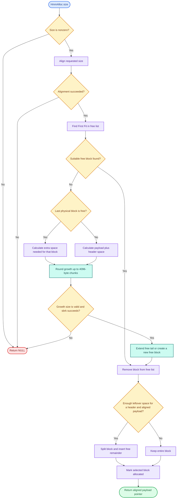
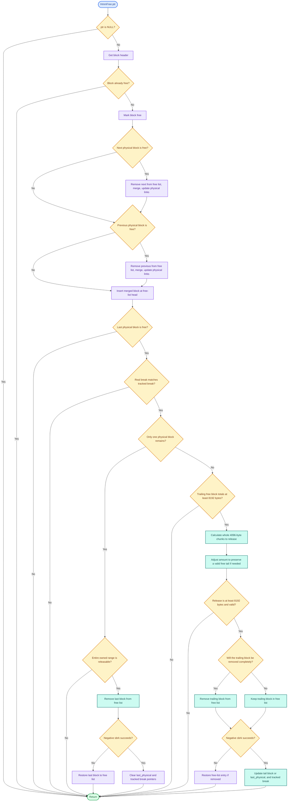

# Heap Memory Manager Flowcharts

These flowcharts follow the implementation in `src/HmmAlloc.c` and `src/HmmFree.c`.

**Colors:** blue = entry, amber = decision, purple = operation, teal = heap / memory operation, green = normal exit, red = allocation failure. The diagrams remain editable Mermaid charts and render directly on GitHub.

## `HmmAlloc()` flowchart

The growth check includes confirming that the real program break still matches the HMM's tracked break before calling positive `sbrk()`.

## `HmmFree()` flowchart

If the entire managed heap is free, `trim_heap()` can return **all** the memory acquired by the HMM, including the initial alignment padding, without applying the 8192-byte threshold. Otherwise, it only returns complete chunks when at least 8192 bytes can be released safely. The diagrams assume `HmmFree()` receives `NULL` or a pointer previously returned by this allocator.
