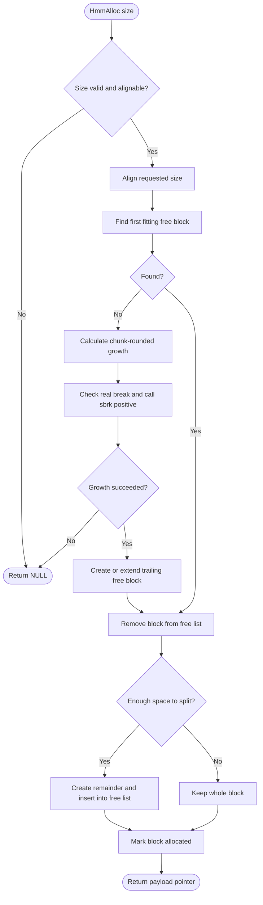
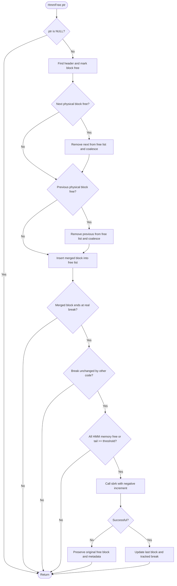

# custom-HMM — Heap Memory Manager

A C heap allocator implementing `HmmAlloc(size_t)` and `HmmFree(void *)` using **real Linux `sbrk()`** for heap growth and shrinking. The original project layout and First Fit design are retained.

## Features

- First Fit allocation through a doubly linked free list.
- Block splitting to reuse excess space.
- Immediate coalescing of adjacent free blocks.
- `max_align_t` alignment for headers and returned payloads.
- Chunk-based growth using `sbrk(positive_increment)`; default chunk is 4096 bytes.
- Trimming of trailing free memory using `sbrk(negative_increment)`.
- Checks for invalid sizes, integer overflow, and `sbrk()` failures.

## Memory layout

A block consists of its padded header followed by its payload:

```text
+----------------------------------------------------------+
| size | is_free | previous_physical | prev_free | next_free|
+----------------------------------------------------------+
| User payload (returned pointer points to its beginning)  |
+----------------------------------------------------------+
```

`size` is usable payload capacity, not including `HEADER_SIZE`. Each block contains a pointer to its preceding *physical* block. `previous_free` and `next_free` link only free blocks; the free-list order is separate from physical address order. The address of the next physical block is derived from `header + HEADER_SIZE + size`.

## Real `sbrk()` and alignment

Unlike the earlier simulated-array version, this implementation has **no fixed `heap_area`**. On the first request it obtains the current break using `sbrk(0)`. It then calls `sbrk()` with a positive increment rounded up to one or more `HEAP_CHUNK_SIZE` chunks. If the original break is not suitably aligned, the first increment also includes a few alignment-padding bytes.

`program_break` tracks the last break set by this allocator; `initial_program_break` remembers the break from before the first growth, so a completely freed heap can be returned to its original position. These variables are bookkeeping for the **real** break, not a simulated heap. To avoid overwriting memory added by an unrelated allocator, growth and trimming are skipped when `sbrk(0)` does not match the allocator's tracked end. This design is intended for a controlled, **single-threaded demonstration program**.

**Important:** `sbrk()` changes the actual process break. Combining this allocator with glibc's own heap allocator, other libraries, or concurrent threads is unsafe. `sbrk()` is a legacy nonportable interface; this project uses it because the assignment explicitly requires it. Do not use the project as an `LD_PRELOAD` replacement for `malloc()`.

## `HmmAlloc(size)` algorithm

1. Reject `size == 0`, overflow in alignment, and unrepresentable `sbrk()` increments.
2. Round the requested size up to `ALIGNMENT`.
3. Find the first free block large enough for the aligned request.
4. If none is available, extend the heap in 4096-byte chunks using real `sbrk()`; when the last physical block is free, extend that block rather than creating another header.
5. Remove the selected block from the free list.
6. Split the block if the remainder can hold another header and a useful aligned payload.
7. Mark the allocated block as used, and return its payload pointer.

### `HmmAlloc()` flowchart



## `HmmFree(ptr)` algorithm

1. Return immediately for `NULL`.
2. Recover the header by subtracting `HEADER_SIZE` from the payload pointer. The caller must pass a valid, active HMM allocation.
3. Mark the block free. Merge with its physically adjacent free successor and predecessor, removing each merged neighbor from the free list and repairing physical links.
4. Insert the merged block into the free list.
5. If it is the last physical block, potentially shrink the real process break using a **checked negative `sbrk()` call**. When *all* HMM blocks are free, release the whole HMM region, including initial alignment padding. Otherwise, trim the whole free tail only when it reaches `TRIM_THRESHOLD` (two chunks), to avoid frequent small decrements.

### `HmmFree()` flowchart



## Build and test

```sh
make clean && make
make verify
```

`make` builds `build/lib/libhmm.a` and the instructor's `build/hmm_test`. **`make test` builds that executable; it does not execute it.** `make verify` builds and runs the standalone, real-`sbrk()` verification without the standard-library wrappers:

```sh
gcc -std=c11 -Wall -Wextra -g -O0 -Iinc \
    -o build/break_patterns \
    verification/break_patterns.c src/HmmAlloc.c src/HmmFree.c
./build/break_patterns
```

The three scenarios adapt the allocation/free patterns of *The Linux Programming Interface* `free_and_sbrk.c` example ([source](https://man7.org/tlpi/code/online/dist/memalloc/free_and_sbrk.c.html)):

1. Free alternating blocks: the break stays at the allocation peak while an allocation remains at the end.
2. Free all but the last block: the break stays at the allocation peak.
3. Free the last half: trailing free blocks coalesce and the break decreases.

Each run uses 100 allocations of 1024 bytes, checks the contents of live blocks, verifies that the number of growth calls is below the number of allocations, and ensures that a final complete free restores the **actual** `sbrk(0)` break to its original address. This is a real-break test, unlike the earlier simulated version.

The original `test/main.c` links `heapWrappers.c`, which redirects `malloc/free/calloc/realloc` to HMM. `hmmCalloc()`, `hmmReAlloc()`, and `hmmSize()` remain *starter-project stubs*. The first three tests exercise the core allocator; the optional `realloc`/`calloc` tests will not pass until those functions are implemented or their `REALLOC_IS_DEFINED` and `CALLOC_IS_DEFINED` flags are disabled in the **test copy**. We keep the instructor's original test unchanged here.

The first instructor test also expects the break to be *exactly equal* to the address recorded after an initial `printf`. With real `sbrk()`, HMM can return a preexisting trailing free chunk too, leaving the break **below** that saved address; the first test can print `failed` even when the memory was correctly released. Use `make verify` for a controlled real-break assertion.

### Valgrind

```sh
valgrind --tool=memcheck --leak-check=full --track-origins=yes ./build/break_patterns
```

Valgrind executes the test and allocator code, but ordinary Memcheck may not associate `HmmAlloc()` payloads with logical heap allocations. A zero-error report therefore does **not** prove all custom-block accesses are valid. Custom-allocation annotations would be a separate debugging improvement. Test without `heapWrappers.c` to avoid intercepting libc allocation calls.

## Limitations

- This is not thread safe and is not intended to coexist with other libraries manipulating the process break.
- `HmmFree()` requires a valid outstanding pointer returned by `HmmAlloc()`. Invalid pointers and double frees are undefined behavior; the `is_free` guard is not a general pointer validator.
- A First Fit list scan is O(n) in the number of free blocks.
- Small free trailing blocks below `TRIM_THRESHOLD` can be retained while other allocations are live.
- `hmmCalloc()`, `hmmReAlloc()`, and `hmmSize()` remain TODOs from the starter code; they are not required by the assignment's `HmmAlloc`/`HmmFree` signatures.
